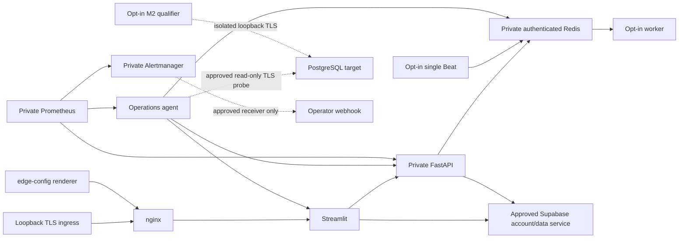

# NEXORA M3 infrastructure and operational readiness

10 November 2026, Asia/Calcutta. Branch: `program/nexora-production-activation`.

**Working infrastructure candidate and reproducible local verification delivered. Staging runtime, PostgreSQL, real identity and public-release acceptance remain OPEN.** No production deployment, Docker daemon operation/container execution, database connection, protected restoration access, live alert delivery, commits/tags/pushes, secret disclosure, destructive cleanup or release-guard bypass occurred.

## A. Infrastructure/configuration files changed

The production entrypoint `docker-compose.production.yml` now includes `deploy/operations/compose.yaml`. Its exact prior bytes are retained in `prior_sources/`. The new candidate preserves Streamlit/FastAPI/Celery/Redis, managed Supabase account/data integration and durable lifecycle storage; it does not replace them with mock authentication or a new application architecture.

New operational artifacts under `deploy/operations/`:

- `compose.yaml`: digest-only images, individually mounted read-only operational helpers, managed file secrets, private network, loopback-only TLS ingress, external named durable volumes, health/startup dependencies, jobs off by default.
- `compose.postgres.yaml`: explicit isolated PostgreSQL 17/TLS/durable-volume profile; no automatic application migration or Auth emulator.
- `compose.qualification.yaml`: explicit one-shot M2 SQL qualification profile. Shares the isolated database's network namespace for verified loopback TLS, preserving the retained local-target safety checks.
- `compose.persistence-test.yaml`, `persistence_probe.py`: separate writer/verifier containers, no network, own synthetic volume. Prepared, NOT RUN in Docker.
- `runtime.py`: secret-file loading, strict startup validation, storage path availability, canonical hostname rendering, worker/PID health and single-host Beat lock.
- `nginx.conf.template`: TLS 1.2/1.3, canonical host/redirect, WebSocket forwarding, bounded body/time/log settings and denied API/admin/metrics/readiness/Auth-server paths.
- `redis-entrypoint.sh`: nonempty independent high-entropy broker/monitor passwords from files; AOF persistence; ping-only monitor ACL; ephemeral restricted config. No password on server command arguments.
- `monitor.py`: private availability/capacity/backup probes, fresh operational readiness file and Prometheus exporter. External probes off by default; no import-time connections.
- `monitoring/{prometheus.yml,alerts.yml,alertmanager.yml}`: private scrape targets, real Prometheus alert rules and managed-file operator webhook routing.
- `recovery.py`, `backup_job.py`, `nexora-backup.service`, `nexora-backup.timer`: bounded authenticated encrypted snapshot packaging, file verification/new-directory recovery, shared backup status and one authoritative host packaging timer. No DB restore or automatic capture/fencing.
- `preflight.py`, `RUNBOOK.md`: source/input guards and concrete startup/shutdown/backup/restore/incident/rollback/qualification commands.

Existing runtime sources intentionally updated:

| File | Concrete change |
|---|---|
| `database/db.py` | `NEXORA_APPLICATION_DB` controls the durable legacy DB and adjacent init lock. Development fallback retained. Production refuses absent/invalid managed credential key; no local key generation or passphrase hashing fallback. |
| `backend/main.py` | Private `/ready` requires fresh complete infrastructure status and never enables protected execution. `/health` stays liveness. Added unhandled-error metric; request labels use route templates, not user-specific paths. Startup/shutdown use FastAPI lifespan. |
| `backend/celery_app.py` | Nine-job registry, explicit unique allowlist, default-off schedules, one Celery authority, qualified queue, bounded prefetch and explicit daily UTC schedules. |
| `backend/celery_tasks.py` | Added discovery wrapper; production tasks recheck the allowlist before work, including stale queued tasks. |
| `backend/jobs/scheduler.py`, `scheduler.py`, `scheduler/scheduler_manager.py` | Production APScheduler starts refuse, preventing duplicate application schedulers. Development behavior retained. |

New verification: `scripts/run_m3_verification.py`, `scripts/validate_m3_compose.py`, three `tests/operations/` modules. No `.dockerignore`, CI/CD workflow, existing nginx guard, telemetry guard, M2 migration or M2 identity gate was weakened. Operational helpers are explicit separate artifacts, not a hidden mount of workspace code over the inspected application payload. Actual images/bundle still require release provenance and inspection before activation.

## B. Topology and dependency mapping



| Service | Startup / state / exposure |
|---|---|
| Redis | Managed auth + AOF; custodian-prepared volume; health before API. No host port or egress network. |
| API | Redis healthy; managed signing/account/backend credentials and durable paths. Private 8000 only; APScheduler disabled. |
| Frontend | API live; stable encryption keys and scoped Auth key. Private 8501 only; no broker or backend service-role secret. |
| edge-config / nginx | Render must complete; frontend healthy. TLS certificate/key mandatory. Only host `127.0.0.1:8512` HTTP health/redirect and `127.0.0.1:8513` TLS frontend. |
| Worker / Beat | `jobs` profile only. API/Redis dependencies; Beat also waits for worker health. Worker uses `nexora-qualified`; Beat gets broker credentials and schedule volume only. |
| Operations | Private API/frontend/Redis availability, storage and backup status; external PostgreSQL/Auth probes require explicit permitted targets and flag. No host port. |
| Prometheus / Alertmanager | Private scrape/routing network, durable metrics/notification state. No host port. Alertmanager alone receives webhook secret. |
| PostgreSQL | Optional `local-postgres` profile; TLS, capped connections, external durable volume; no host publication and no auto-M2 SQL. It does not substitute for Supabase Auth. |
| Qualification client | `qualification` AND local PostgreSQL profiles require named disposable-target authorization; fixed retained install/test package, restrictive pgpass and verified TLS. No application authority granted. |

Ten base service definitions include two opt-in job services and one completed init service; two more definitions are in the optional database/qualification overlays. All inter-service ports remain internal. Public ingress, API/Auth publication and multi-host scale are not activated. Single-host local storage/SQLite remains the accepted deployment shape; network-filesystem SQLite and multi-host Beat coordination are not qualified.

## C. Persistence and recovery implementation

- External, explicit, non-aliasing named volumes hold application DB, lifecycle evidence, encrypted prospect data, Redis AOF, scheduler state, operational status/config and Prometheus/Alertmanager state. Wrong/missing volume identity cannot silently create an empty replacement application store. UID/permissions must be prepared by the custodian; startup refuses unavailable durable paths.
- `NEXORA_APPLICATION_DB`, `NEXORA_UNIVERSAL_EVIDENCE_DB`, `NEXORA_PROSPECT_DATA_ROOT` point to `/var/lib/nexora/...` mounts. Stable credential/prospect Fernet keys come from managed files. Missing/invalid production credential keys no longer generate a new local key.
- Existing prospect encryption/wrapped tenant keys are retained. Backups authenticate/encrypt the whole bounded archive and manifest. Local tests recovered an actual prospect tenant's wrapped-key format and decrypted a synthetic source after file restoration; wrong master key failed. No real customer/key escrow data was used.
- Snapshot packaging requires fresh operator-coordinated database/file snapshot IDs, operator reference and aware capture time. It rejects stale/uncoordinated snapshots, unsafe paths/links/managed key material, missing roots/dump and overwrite targets; file hashes and archive authentication/key ID are checked before recovery. No database connection/SQL restore occurs; result explicitly says `database_restored=false`.
- Backup status is atomically handed off through the same external host directory mounted read-only by monitoring. Failure preserves last-success time. A dedicated group-readable 0640 non-secret status handoff joins the host backup user to the read-only operations mount; actual Linux UID/GID/ACL mapping still requires qualification. The host timer is the only packaging scheduler and is not installed/enabled here.
- `recovery.py` is a 256 MiB/10,000-file in-memory bounded implementation, not a large-production streaming backup engine. Actual provider-native capture, external writer/Auth fencing, offsite/immutable retention, role/ACL-aware SQL restore and measured RPO/RTO remain prerequisites.

**Encryption distinction:** prospect content and credential fields have application encryption; backup archives are encrypted. The application/lifecycle SQLite files as a whole are not encrypted by Fernet. Their external volumes MUST have qualified host/storage-provider encryption at rest and key custody. No fake environment flag was used as proof of encryption. Actual storage-provider encryption, real master-key recovery and real database restore remain NOT VERIFIED.

The packaging timer does not implement an unapproved cross-system snapshot algorithm. It consumes an externally coordinated, fresh quiesced capture and fails closed without one. This is not complete unattended production backup automation. The runbook names the missing capture coordinator, maintenance/fencing duties, independent key escrow and role/ACL preservation steps. No protected restoration target was used, no volume/data cleanup was performed, and no destructive rollback commands are supplied.

## D. Monitoring and alerting implementation

- Private API `/health` is liveness. `/ready` requires a fresh (<=120 seconds), non-future, complete operational record, sufficient storage, current backup packaging and available dependencies; it always reports protected execution disabled. Infrastructure readiness is not release/security acceptance.
- PostgreSQL probe: fixed `SELECT 1`, `sslmode=verify-full`, dedicated managed least-privilege config, bounded connection/statement timeouts and default-read-only session. No actual probe executed. No automatic RLS/integrity qualification is inferred from availability.
- Auth probe is HTTPS health availability, never proof of an independently authenticated operator, current session, MFA, authorization or fencing. Missing/protected provider health support remains failed/unverified until a real scoped probe is qualified.
- Storage free-space/available-byte metrics cover application/evidence/prospect mounts and the shared encrypted archive directory. Managed PostgreSQL capacity/replication/PITR metrics require the provider's own integration; they are not fabricated by this local exporter.
- Backup last-success/attempt gauges, stale-probe age and missing/degraded readiness remain visible. A dead sampling loop cannot indefinitely imply fresh readiness; API age checks and stale-probe alerts fail closed.
- API error/5xx metrics, bounded logs and route-template labels provide application error monitoring without sending stack traces/customer context to an unconfigured external provider.
- Alert rules route scrape/dependency failure, stale probes, blocked readiness, storage pressure, backup failure/staleness, API/unhandled errors and notification failure to the named managed webhook. No live webhook, email or message was sent. Receiver delivery/acknowledgement and native promtool/amtool parsing remain unexecuted qualification.
- Exactly one application schedule registry: nine Celery entries, jobs off until a unique qualified allowlist is supplied. Three production APScheduler starts refuse. Single-host Beat lock/PID state and node-specific worker health are prepared. Beat PID liveness is not job progress/exactly-once proof; retries/redelivery/idempotency and actual job effects need per-job qualification.

The full runbook includes schedule ownership/times, incident handling for unavailable dependencies, missing keys, stale/failed backups, duplicate scheduling and unknown commits. The backup packaging timer and monitoring sample/scrape intervals do not duplicate business job scheduling.

## E. Exact executed verification

```powershell
.venv/Scripts/python.exe -m scripts.run_m3_verification
.venv/Scripts/python.exe -m scripts.validate_m3_compose
.venv/Scripts/python.exe -m deploy.operations.preflight
git diff --check
```

Final offline result: **385 passed, zero failures/skips/warnings**. Eighteen Python sources parsed. Suite contains the full selected M1/M2-C regression (including M2-A/M2-B), M3 runtime/configuration/health/scheduler/recovery tests, existing backup-command mocks and tenant-scoped recommendation job tests. Exact command/per-case machine results: `offline/checks.json`, `offline/results.xml`, `offline/pytest.log`.

Verified locally:

- Strict secret-file/config/key/path/hostname checks and denied missing/ambiguous/invalid production state.
- Source/runtime single scheduler ownership, explicit task allowlists, refusal of disabled queued work, and default-off jobs.
- Private liveness versus missing/stale/invalid readiness; failure/capacity/backup visibility and no protected-execution enablement.
- Authenticated encrypted archive/file restoration, unsafe-path/overwrite/wrong-key/stale-capture denial, preserved backup failure state, fresh Python-process persistence and actual synthetic prospect wrapped-key recovery.
- JSON/YAML configuration loading and native **Docker Compose CLI schema parsing** of the root production file plus both optional overlays/all profiles, using only synthetic inputs, dummy image digests, allowlisted child environment and isolated CLI config.
- `preflight` structure PASS for ten base service definitions; tracked diff whitespace check PASS (only unrelated Git line-ending advisories).

Docker evidence: `compose-validation/result.json`, `compose-config.json`, `stderr.log`. Final status PASS with `synthetic_inputs=true`, `environment_sanitized=true`, `docker_daemon_accessed=false`, `containers_executed=false`, `database_connections=false`. No builds, pulls, network probes, container replacement, Linux permissions/locks, Nginx TLS/native syntax, Redis runtime, Prometheus rule evaluator, webhook, real backup/restore or PostgreSQL test was executed. A schema PASS cannot certify those behaviors.

Initial checks are not hidden: the first expanded suite passed 376 with inherited FastAPI event deprecation warnings; lifespan migration removed them. A sanitized Windows Docker plugin-discovery attempt failed with `unknown flag: --env-file`; its result/stderr are retained under `attempt-sanitized-plugin-discovery-failure-*`. The verifier now invokes the installed Compose plugin directly with an isolated config and sanitized environment. The initial version query reported denied access to personal Docker configuration; no credentials were obtained, and later checks do not use that configuration. No daemon access failure was used to infer target permission.

Preservation: 120 baseline artifacts fingerprinted; eight intentional runtime/production-entrypoint changes, **zero unexpected changes**. The prior bytes for all eight changed files are retained under `prior_sources/`. The other 112 fingerprinted artifacts, all six original migrations, A022, prior milestone reports/evidence, M2 identity gates and release guards remain unchanged. Source/artifact hashes and intentional-change mappings are retained alongside this report. No unrelated dirty worktree change was restored or removed.

## F. Staging deployment prerequisites

1. Named authorization for an isolated staging daemon/host and any local database, exact targets and resource ownership. CLI availability is not daemon/database permission. No authorization is inferred from a loopback process, installed binary or environment flag.
2. Inspected exact-candidate images/digests with current runtime changes, mounted operational-bundle manifest, required Linux dependencies and provenance. Current uncommitted work is not a published release; CI/publication safeguards remain intact.
3. Custodian-provisioned distinct external volume identities, correct UIDs/ACLs, single-host durable storage, actual encryption-at-rest/key-unseal evidence and enough capacity. Never infer permission to reinitialize/re-chown retained data.
4. Managed stable keys/credentials/TLS files outside the repository, approved canonical DNS/certificate/SANs, account/data endpoint and dedicated verified-TLS read-only PostgreSQL monitor role. The public config must contain no credential values. Broker and ping-only monitor credentials are independent.
5. Approved outbound service endpoints/firewall policy, HTTPS notification receiver and operator incident ownership. No API/database/telemetry/admin host exposure; ingress remains loopback until separately approved public-release changes.
6. Qualified capture coordinator, snapshot/fencing window, independent key escrow, offsite/retention controls, restore target/procedure and measured RPO/RTO. Packaging-only success does not establish these.
7. Native component configuration checks, actual health/start dependencies, resource/UID behavior, Beat lock and controlled container replacement with synthetic data. Exact commands are in `deploy/operations/RUNBOOK.md`; none of these container tests ran here.

## G. M2 PostgreSQL and identity qualification readiness

`staging-qualification/qualification-manifest.json` and compatibility output were regenerated into the M3 evidence directory, preserving prior evidence. Package order remains M2-A S020/enforcement/private writer, its rollback-only fixture, M2-B S021/integrity/interfaces, A022 result linkage, M2-B fixture and privilege/recovery tests. Bootstrap requires an authorized blank disposable cluster; roles are cluster-global. No normal application service runs these migrations.

The optional client uses the database service's network namespace, verified loopback TLS and a restrictive managed pgpass. Contracts/tests are individually mounted read-only from the manifest-checked candidate root. The local guard was not relaxed to accept arbitrary Docker addresses. Server bootstrap credentials go only to that isolated fixture/client, never normal application/monitor roles.

All PostgreSQL constraints/triggers/immutability/RLS/grants/concurrency/revocation/unknown-commit/component rollback tests remain **NOT RUN**. Existing M2-C guarded race and temporary-table driver probe are prepared, not executed. Successful authorized provisioning/approval/owner E2E and current receipt/status reads remain disabled pending real identity, operation-to-organization authority, independent approval policy, D08/result/D10 contracts and cross-system fencing/atomic adapters. Auth health or infrastructure readiness supplies none of that assurance. No mock verifier or Keycloak development path was activated.

## H. Remaining external access/operator dependencies

- Authorized isolated daemon, qualified cached images, target credentials/certificates, external volumes/UIDs, host encryption/key custody and actual replacement/recovery drill.
- Live PostgreSQL/Supabase catalog/role compatibility and full-history checker cost/visibility/concurrency qualification on permitted targets; no production or restoration project access.
- Real owner human/session verifier, current authority/scope binding, approval/validator policy, technical/succession evidence, cross-system fences, canonical digest/result/read contracts and atomic workflow adapters. M3 does not add an environment bypass for these dependencies.
- Missing retained DBR-01 v0.2/v0.3 disposition and prior M0/M1/M2 external qualifications remain as recorded. Offline acceptance is preserved; external acceptance is not fabricated.
- Actual monitored provider health support, managed PostgreSQL capacity/PITR telemetry, Redis ACL/client interoperability, Prometheus/Alertmanager/native TLS checks and approved test notification receipt.
- Capture/maintenance coordinator, larger-data backup mechanism where this bounded utility is insufficient, offsite replication/immutability, real role/ACL-aware SQL restore, escrow drill and accepted RPO/RTO.
- Per-job tenant/authority/idempotency/error/redelivery qualification before activating any allowlisted scheduled job. Production jobs remain off by default; legacy schedulers refuse.

## I. M3 completion recommendation

Recommend accepting the **implemented M3 repository/local-verification scope**: working configuration, operational guards, encrypted recovery tooling, monitoring/alert rules, explicit scheduler ownership, prepared isolated staging package and reproducible 385-test/Compose-schema evidence are delivered. Do not claim operational staging acceptance or public-release readiness. Actual containers, storage/crypto custody, component binaries, SQL behavior, real identity/authority, recovery and alert delivery remain unqualified; no deployment was performed.

## J. M4 product acceptance preparation

Freeze the reviewed candidate/bundle/image/source hashes, target authorizations and acceptance evidence before starting M4. Use synthetic tenant data and separately authorized real test accounts/providers; never replace production identity with a success stub.

| Acceptance area | Required staging evidence |
|---|---|
| Startup/ingress | Actual image startup/UID/secret/TLS checks; frontend works through canonical HTTPS/WebSocket; API/admin/metrics/Auth-server paths stay denied publicly. |
| Account/tenant | Real supported sign-in, UID-bound/current membership, tenant A/B isolation, account disable/token revocation; no default tenant or role-to-owner shortcut. |
| M2 database | All seven SQL artifacts, effective privileges/RLS/immutability, complete-history checks, races/replays, revocation ordering, rollback and original-ID/key unknown-commit reconciliation. |
| Provisioning/approvals | Real owner/approval/identity/fence/atomic adapters first. Record positive durable completion only after COMMIT acknowledgement and evidence linkage; current 503/403 denial is a safety test, not feature acceptance. |
| Persistence/keys | Controlled synthetic application-container replacement, same external volumes/keys, actual prospect/credential decrypt, lifecycle data continuity, coordinated SQL/file restore and independent key-custody drill. |
| Operations/jobs | Dependency loss/readiness, capacity/backup failure/stale-probe alerts, approved receiver acknowledgement, duplicate Beat refusal, disabled queued-task denial and qualified job effects. |
| Recovery/release | Measured RPO/RTO, offsite/retention proof, previous-qualified-digest rollback with unchanged volumes/keys and preserved release/security safeguards. |

Mark unavailable external controls NOT_VERIFIED/BLOCKED, never PASS from offline or synthetic evidence. M4 does not itself authorize production SQL, protected restoration, deployment, cleanup, commits/tags/pushes or release-guard changes.

Operational references consulted: official Docker [secrets](https://docs.docker.com/compose/how-tos/use-secrets/), [startup conditions](https://docs.docker.com/compose/how-tos/startup-order/) and [Compose include](https://docs.docker.com/reference/compose-file/include/); Celery [single periodic scheduler](https://docs.celeryq.dev/en/stable/userguide/periodic-tasks.html); nginx [TLS configuration](https://nginx.org/en/docs/http/configuring_https_servers.html); Prometheus [alerting rules](https://prometheus.io/docs/prometheus/latest/configuration/alerting_rules/) and [Alertmanager routing](https://prometheus.io/docs/alerting/latest/configuration/); PostgreSQL [dump semantics](https://www.postgresql.org/docs/17/backup-dump.html). Documentation review is not runtime qualification.
